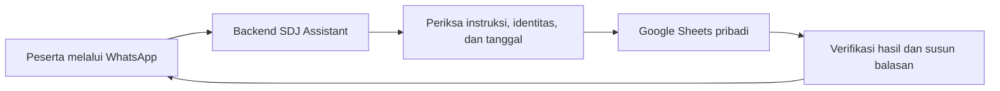

# SDJ Assistant

**Catat aktivitas SDJ lewat WhatsApp, simpan langsung ke Google Sheets pribadi.**

SDJ Assistant adalah asisten pencatatan **Spiritual Development Journey (SDJ)** untuk peserta yang menggunakan tracker SDJ. Proyek ini membantu mencatat ibadah dan kebiasaan harian melalui percakapan WhatsApp, melihat progres, serta memperbaiki catatan yang keliru.

Mengisi tracker setiap hari berarti membuka spreadsheet, mencari tanggal, lalu memilih baris aktivitas. SDJ Assistant menyederhanakan proses itu menjadi pesan seperti `zuhur 3, tilawah 2 halaman, dhuha sudah`. Aplikasi memeriksa instruksi, memperbarui tracker yang sudah dihubungkan, lalu mengirim hasilnya kembali ke WhatsApp.

[Tentang aplikasi](https://app.sdj-rumah-kepemimpinan.my.id) · [Kebijakan privasi](https://app.sdj-rumah-kepemimpinan.my.id/privacy) · [Ketentuan penggunaan](https://app.sdj-rumah-kepemimpinan.my.id/terms)

## Apa yang bisa dilakukan?

- **Mencatat 15 aktivitas SDJ**, dengan maksimal lima aktivitas dalam satu pesan.
- **Memahami instruksi sehari-hari**, termasuk angka dalam kata dan tanggal seperti “kemarin” atau “dua hari lalu”. Bot meminta penjelasan jika informasi belum lengkap.
- **Menampilkan rekap harian dan progres bulanan** dari tracker pribadi.
- **Mengoreksi dan membatalkan catatan.** Undo berlaku untuk seluruh kelompok pencatatan terakhir dalam 10 menit, selama nilainya belum berubah.
- **Mengirim pengingat** pukul 07.00, 13.00, dan 20.00 WIB saat fitur diaktifkan oleh pengelola. Peserta bisa mengatur pengingat melalui chat.
- **Memeriksa kesesuaian tracker** saat penghubungan, dengan pilihan memperbaiki aturan dan nilai input yang tidak sesuai.

## Contoh penggunaan

Kirim pesan melalui **DM WhatsApp** ke bot setelah tracker terhubung:

| Kebutuhan                       | Contoh pesan                                        |
| ------------------------------- | --------------------------------------------------- |
| Menghubungkan tracker           | `daftar`                                            |
| Mencatat satu aktivitas         | `zuhur 3`                                           |
| Mencatat beberapa aktivitas     | `zuhur 3, tilawah 2 halaman, dhuha sudah`           |
| Mencatat untuk hari sebelumnya  | `subuh kemarin 2`                                   |
| Menggunakan bahasa sehari-hari  | `Dua hari lalu aku baca Quran dua setengah halaman` |
| Mengoreksi nilai                | `Eh tilawah kemarin ganti jadi tiga halaman`        |
| Melihat catatan hari ini        | `rekap hari ini`                                    |
| Melihat progres bulanan         | `rekap bulan ini`                                   |
| Membatalkan pencatatan terakhir | `batal`                                             |
| Mematikan pengingat             | `reminder mati`                                     |
| Mengaktifkan kembali pengingat  | `reminder aktif`                                    |
| Memeriksa koneksi atau panduan  | `status` atau `bantuan`                             |

Perintah sederhana seperti `zuhur 3` diproses langsung tanpa AI. Untuk memahami bahasa bebas yang lebih beragam, aplikasi menggunakan AI setelah peserta memberikan persetujuan. Ketersediaan pemahaman bahasa bebas mengikuti ketersediaan dan batas pemakaian penyedia AI.

## Aktivitas yang didukung

| Aktivitas                          | Bentuk catatan                              |
| ---------------------------------- | ------------------------------------------- |
| Subuh, Zuhur, Ashar, Maghrib, Isya | Skor 0–3 sesuai aturan tracker SDJ          |
| Salat sunnah rawatib               | Jumlah kali pelaksanaan                     |
| Tilawah Al-Quran                   | Jumlah halaman, termasuk pecahan            |
| Murojaah Al-Quran                  | Sudah / belum                               |
| Al-Matsurat pagi dan petang        | Sudah / belum untuk masing-masing waktu     |
| Dhuha dan Tahajjud                 | Sudah / belum untuk masing-masing aktivitas |
| Infaq / ajak infaq                 | Sudah / belum                               |
| Puasa sunnah                       | Sudah / belum                               |
| Merapikan kamar                    | Sudah / belum                               |

Nilai kosong dibedakan dari skor `0` dan jawaban `belum`. Aplikasi mencatat nilai yang diberikan peserta dan tidak menyimpulkan suatu aktivitas sudah dilakukan hanya dari waktu atau isi percakapan yang tidak jelas.

## Bagaimana mulai menggunakannya?

1. Kirim `daftar` ke nomor WhatsApp bot yang diberikan pengelola SDJ Assistant.
2. Buka tautan pribadi dari balasan bot, lalu login dengan akun Google.
3. Pilih file Google Sheets dan tab tracker SDJ yang ingin dihubungkan. File harus berupa Google Sheets dan dapat Anda edit.
4. Ikuti pemeriksaan tracker. Jika memilih **Validasi & perbaiki**, aplikasi menormalkan input aktivitas dan menyimpan cadangan nilai, rumus, serta aturan asal pada tab tersembunyi di file yang sama sebelum perubahan. Rumus rekap, target, catatan sel pribadi, dan tampilan dipertahankan; rumus tepat di sel input aktivitas dapat diganti dengan hasil yang valid atau dikosongkan.
5. Konfirmasikan aktivasi melalui DM WhatsApp asal. Setelah aktif, Anda dapat mulai mencatat dan meminta rekap.

Setiap peserta menghubungkan tracker pribadinya sendiri. Peserta cukup berinteraksi melalui WhatsApp dan browser untuk proses penghubungan.

## Cara kerja dan privasi

Google Sheets menjadi sumber nilai aktivitas harian. Database menyimpan koneksi peserta, persetujuan, antrean pekerjaan, dan riwayat perubahan yang diperlukan untuk menjalankan layanan serta memulihkan kegagalan.

- **Tracker terikat pada identitas peserta.** Isi pesan tidak dapat dipakai untuk memilih akun atau tracker peserta lain.
- **Akses Google mengikuti file yang dipilih.** Penghubungan menggunakan login Google dan Google Picker, tanpa meminta akses umum ke seluruh Google Drive.
- **AI membantu memahami instruksi.** Backend tetap memvalidasi aktivitas, nilai, tanggal, dan hak akses sebelum menulis. Teks instruksi serta konteks klarifikasi yang relevan dapat dikirim ke penyedia AI sesuai persetujuan peserta; token Google tidak dimasukkan ke permintaan AI.
- **Hasil penulisan diperiksa ulang** sebelum aplikasi menyatakan catatan berhasil disimpan. Jika hasil belum dapat dipastikan, bot menyampaikan status tersebut.
- **Peserta dapat menghentikan akses.** Perintah `putus koneksi` dan `hapus akun` meminta konfirmasi. Penghapusan akun aplikasi tidak menghapus file Google Sheets pribadi.

Rincian pemrosesan data, penyedia layanan, dan masa penyimpanan tersedia pada [Kebijakan Privasi](https://app.sdj-rumah-kepemimpinan.my.id/privacy).

## Cakupan proyek

SDJ Assistant berfokus pada pencatatan tracker SDJ melalui DM WhatsApp. Saat ini satu peserta menghubungkan satu tracker aktif. Pencatatan mendukung hari ini dan tanggal lampau maksimal 31 hari ke belakang, selama tanggal tersedia pada tracker.

Operasi menambah nilai secara relatif, seperti “tambah tilawah 2 halaman”, belum didukung; gunakan nilai akhir yang ingin dicatat. Rekap bulanan membutuhkan header tanggal lengkap untuk periode yang diminta dan tidak menebak target pribadi. Pengingat mengikuti jadwal tetap, termasuk ketika catatan sudah terisi.

Proyek ini masih dikembangkan. Riwayat implementasi, bukti pengujian, dan validasi yang masih perlu diselesaikan dicatat pada [status implementasi](docs/IMPLEMENTATION_STATUS.md).

## Teknologi dan isi repository

Backend menggunakan **TypeScript dan Node.js**, dengan **Fastify** untuk API, **Supabase PostgreSQL** untuk data operasional, **Google OAuth / Picker / Sheets API** untuk penghubungan tracker, serta **OpenClaw dan bridge khusus** untuk kanal WhatsApp. Interpretasi bahasa bebas menggunakan router backend untuk Groq, Google Gemini, NVIDIA, dan OpenRouter sesuai konfigurasi serta persetujuan peserta.

| Direktori                                    | Isi                                                                                 |
| -------------------------------------------- | ----------------------------------------------------------------------------------- |
| [`apps/api`](apps/api)                       | API, halaman publik, dan alur penghubungan Google                                   |
| [`apps/worker`](apps/worker)                 | Pemrosesan pekerjaan dan pengingat di latar belakang                                |
| [`packages`](packages)                       | Aturan aktivitas, validasi, logika aplikasi, integrasi layanan, dan bridge WhatsApp |
| [`supabase/migrations`](supabase/migrations) | Perubahan struktur database                                                         |
| [`tests`](tests)                             | Pengujian unit, integrasi, alur aplikasi, dan evaluasi interpretasi AI              |
| [`docs`](docs)                               | Desain, keputusan teknis, status implementasi, dan panduan operasional              |
| [`deploy`](deploy)                           | Konfigurasi dan skrip deployment                                                    |

Untuk mempelajari implementasi atau berkontribusi, mulai dari [peta dokumentasi](docs/README.md), [panduan kontribusi](docs/AGENTS.md), [panduan operasional](docs/runbooks/operations.md), dan [panduan deployment](docs/runbooks/vps-deployment.md). Pengaturan Google dijelaskan pada [panduan Google OAuth](docs/runbooks/google-oauth.md).
