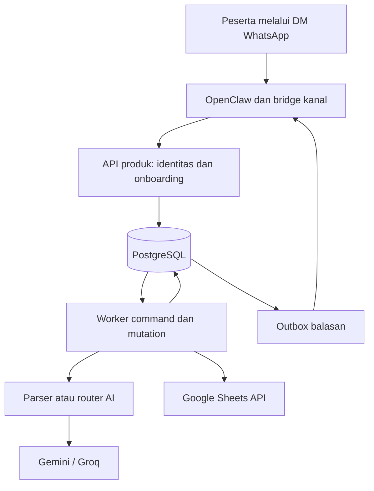
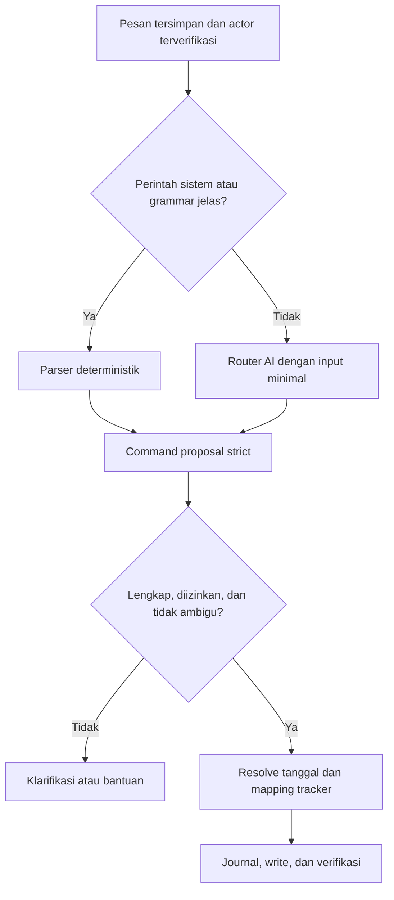

# Architecture: SDJ Assistant

Versi: 1.0.0  
Tanggal: 15 Oktober 2026  
Status: keputusan desain, belum diimplementasikan  
Rujukan: [PRD.md](PRD.md), [SCHEMA.md](SCHEMA.md), [AGENTS.md](AGENTS.md).

## 1. Keputusan utama

Bangun **modular monolith** TypeScript dengan proses API dan worker yang berasal dari codebase sama. Gunakan PostgreSQL untuk konfigurasi peserta, journal, antrean, outbox, dan koordinasi kuota. Tidak memerlukan Redis, vector database, framework multiagent, atau message broker tambahan pada MVP.

OpenClaw diperlakukan sebagai dependency kanal di sisi operator. Backend produk mengelola isolasi peserta, OAuth, pemetaan tracker, parser, router AI, dan penulisan Google Sheets. Tidak ada token Google atau database credential pada prompt, memori agent, atau workspace OpenClaw.

Pemisahan ini memperjelas rancangan percakapan sebelumnya: dukungan fallback bawaan OpenClaw memang ada, tetapi **router backend adalah satu-satunya pemilik retry/fallback untuk interpretasi SDJ**. Mengaktifkan dua lapisan fallback sekaligus akan mengaburkan anggaran request, deadline, dan audit.

## 2. Konteks dan batas kepercayaan



### Batas yang wajib dipahami

- Pesan pengguna, teks spreadsheet, dan output model adalah data tidak tepercaya.
- Actor dibentuk dari metadata kanal yang diterima bridge operator, kemudian diverifikasi backend. Actor tidak dibentuk dari parameter tool yang ditulis model.
- Bridge merupakan komponen tepercaya yang dapat mengirim event identitas. Jika bridge atau akun operator diambil alih, isolasi backend tidak dapat membuktikan bahwa actor yang dilaporkan benar. Credential bridge harus dibatasi, diaudit, dan dapat dirotasi.
- Dokumentasi OpenClaw menyatakan bahwa gateway bukan batas keamanan untuk hostile multi-tenancy. Isolasi sesi membantu konteks percakapan tetapi tidak menggantikan otorisasi aplikasi. Jangan menempatkan peserta langsung sebagai pengguna agent dengan tool berkewenangan luas. [S1] [S2]
- Peserta tidak memiliki endpoint untuk memilih `user_id`, Google connection, spreadsheet ID, sheet ID, atau A1 range pada operasi sehari-hari.

## 3. Stack target dan struktur repository

### Stack target

| Area | Pilihan desain | Alasan |
| --- | --- | --- |
| Runtime backend | Node.js 24 LTS, TypeScript strict | Satu bahasa untuk API, worker, dan adapter |
| API | Fastify, versi kompatibel Node yang dipin saat bootstrap | Validasi boundary dan API ringan |
| Database | PostgreSQL 17, `pg`, migration SQL berversi | Antrean dan journal satu transaksi lokal |
| Validasi | Zod dengan schema strict | Satu kontrak runtime untuk input dan output AI |
| Testing | Vitest, PostgreSQL disposable, adapter palsu | Uji isolasi dan crash tanpa dependency nyata |
| Google | OAuth web-server, Google Picker, Sheets API v4 | Penautan file dan penulisan terarah |
| AI | Adapter Gemini dan Groq langsung dari backend | Kontrak dan retry terpusat |
| Kanal | OpenClaw + bridge yang lolos G0 | Mengikuti rencana pengguna tanpa mengasumsikan API plugin |
| Hosting awal | Docker Compose, satu API, satu worker, PostgreSQL | Mudah direproduksi untuk pilot |
| UI onboarding | Halaman server-rendered minimal | Login Google, Picker, status koneksi, konfirmasi |

Node 24 adalah target proyek, bukan klaim minimum OpenClaw. Runtime OpenClaw boleh berbeda sesuai rilis yang dipin. Pilih patch release aktif dan kompatibilitas dependency berdasarkan dokumentasi saat implementasi. Jangan menggunakan tag `latest` pada deployment. [S13]

### Struktur rencana

```text
sdj-assistant/
  PRD.md
  ARCHITECTURE.md
  SCHEMA.md
  AGENTS.md
  CLAUDE.md
  README.md
  apps/
    api/src/                 # HTTP, onboarding, auth, internal channel API
    worker/src/              # durable job runner, write/reconcile, outbox
  packages/
    domain/src/              # command, date resolution, rules, typed values
    contracts/src/           # Zod schemas, errors, envelope versions
    application/src/         # use cases, transaction and authorization boundary
    infrastructure/src/
      db/                    # pg repositories and transaction context
      google/                # OAuth, Picker support, Sheets adapter
      ai/                    # router, Gemini adapter, Groq adapter
      channel/               # product-side channel contracts
    openclaw-bridge/          # exact SDK integration only after G0
    testing/                 # synthetic fixtures, fakes, deterministic clock
  db/migrations/
  config/templates/
  config/models/
  tests/integration/
  tests/e2e/
  tests/evaluation/
  docs/adr/
  docs/spikes/
  docs/runbooks/
  scripts/
```

Directory selain enam dokumen awal adalah rencana, belum tersedia. Domain tidak mengimpor SDK Google/OpenClaw/provider atau transport HTTP. Application bergantung pada interface. Infrastructure mengimplementasikan interface tersebut.

## 4. Gate G0: kelayakan bridge OpenClaw

Sebelum mengintegrasikan data asli, lakukan spike pada versi OpenClaw yang dipin. Simpan temuan pada `docs/spikes/openclaw-channel.md`.

Spike harus membuktikan:

1. Menerima pesan DM dengan ID event, akun bot, identitas sender dan conversation dari metadata asli.
2. Memisahkan identitas nomor/E.164 dan opaque sender ID. Jika nomor tidak tersedia, gunakan opaque ID stabil yang diverifikasi, jangan mengarang nomor dari teks.
3. Menyerahkan pesan ke backend tanpa harus memanggil model dan tanpa agent default menjawab juga.
4. Mengirim balasan ke conversation yang ditentukan backend dan menghubungkannya dengan event asal.
5. Mengendalikan redelivery, echo `fromMe`, history replay setelah reconnect, dan persistensi sesi kanal.
6. Menonaktifkan group chat, tool shell/browser/filesystem, dan memori lintas pengguna pada jalur produk.
7. Tidak menyimpan token Google. Transkrip OpenClaw mengikuti kebijakan retensi produk atau dinonaktifkan.

Nama hook, metode SDK, dan konfigurasi plugin tidak ditetapkan oleh dokumen ini. Gunakan hanya API yang benar-benar tersedia pada versi yang diuji. Interface internal pada bagian 5 adalah API milik produk yang akan dibuat, bukan klaim endpoint bawaan OpenClaw.

Jika salah satu kebutuhan tidak didukung, jangan menyamarkannya dengan prompt atau mengirim identitas lewat argumen model. Pertahankan fake channel, dokumentasikan hambatan, dan usulkan adapter WhatsApp Business Platform atau gateway terpisah melalui ADR. Tidak mengganti kanal atau membuat akun eksternal diam-diam.

## 5. Kontrak kanal internal

### Ingress

`POST /internal/v1/channel-events` menerima envelope versi 1 pada jaringan privat atau koneksi TLS terautentikasi.

```json
{
  "version": 1,
  "event_id": "synthetic-event-001",
  "channel": "whatsapp",
  "channel_account_id": "bot-pilot",
  "sender_id": "synthetic-peer-a",
  "conversation_id": "synthetic-dm-a",
  "is_direct": true,
  "is_from_bot": false,
  "sent_at": "2026-10-15T09:00:00Z",
  "text": "zuhur, 3"
}
```

`received_at` ditetapkan backend pada insert pertama. Request ditandatangani HMAC-SHA256 atas `timestamp + newline + nonce + newline + rawBody`. Header internal: `X-SDJ-Key-Id`, `X-SDJ-Timestamp`, `X-SDJ-Nonce`, `X-SDJ-Signature`. Maksimal skew 60 detik. Nonce hash disimpan 5 menit untuk menolak replay. Bandingkan signature constant-time. Batasi body 8 KiB, text 1.000 karakter. Semua angka merupakan default desain yang dapat dikonfigurasi.

Key ID mempunyai allowlist `channel_account_id`. Signature yang valid tetapi memakai akun bot di luar scope ditolak. Adapter retry menggunakan nonce baru tetapi `event_id` sama, sehingga anti-replay dan deduplikasi pesan tidak bertentangan. Signature transport tidak membuktikan identitas jika host bridge telah dikuasai.

Respons: 202 hanya setelah message dan job persisten, atau 200 untuk duplikat yang sudah tersimpan. Signature salah 401, scope salah 403, schema salah 400, body terlalu besar 413, database gagal 503. Jangan mengirim ack sukses sebelum commit.

### Egress

- Bridge memanggil `POST /internal/v1/deliveries/claim` dan menerima payload balasan, destination, lease token, dan delivery ID dari backend.
- Bridge mengirim melalui API kanal yang sudah diuji G0.
- `POST /internal/v1/deliveries/{id}/ack` mencatat remote message ID setelah terkirim. `.../nack` melaporkan kegagalan terklasifikasi.
- Endpoint terautentikasi key akun kanal yang sama. Ack harus cocok dengan akun, lease token, dan delivery ID.
- Destination diambil dari route yang direkam pada pesan pengguna, tidak pernah dari output model. URL callback atau destination arbitrary ditolak.
- Satu komponen mengirim balasan produk. Auto-reply agent OpenClaw dimatikan pada jalur ini.
- Outbox mencegah hilangnya notifikasi setelah commit. Delivery tepat sekali tidak dijamin jika kanal tidak menyediakan idempotency native. Timeout kirim balasan dapat menghasilkan status `delivery_unknown`, tanpa mengulang mutation spreadsheet.

## 6. Identitas, otorisasi, dan Google onboarding

### Identitas aplikasi

`(channel, channel_account_id, sender_id)` menjadi kunci identitas. `sender_id` adalah opaque identifier dari adapter, bukan display name. E.164 disimpan terpisah bila tersedia. Hash HMAC digunakan untuk lookup, ciphertext untuk routing bila diperlukan. MVP hanya DM, tanpa peserta memilih nomor lain atau tracker lain lewat chat.

Sesi chat aplikasi dikunci ke user dan identity tersebut. Hindari state percakapan global pada SDK. Konteks hanya command pending dari peserta yang sama.

### OAuth dan pairing

1. Pesan `daftar` menghasilkan token onboarding acak 256 bit, hashed di DB, berlaku 10 menit dan sekali pakai.
2. Tautan menukar token menjadi browser session cookie `HttpOnly`, `Secure`, `SameSite=Lax`, lalu redirect untuk menghilangkan token dari URL. Terapkan `Referrer-Policy: no-referrer` dan jangan memuat analitik pihak ketiga.
3. OAuth authorization code flow memakai `state` acak terikat sesi dan PKCE S256 jika didukung library. Validasi redirect URI tetap, state sekali pakai, expiry, issuer/audience/nonce untuk ID token bila digunakan. Identitas Google menggunakan subject stabil, bukan email sebagai primary key.
4. Minta scope file minimal `drive.file`, ditambah scope identitas yang memang dibutuhkan. Peserta memilih file melalui Picker. Backend menerima file ID pilihan lalu melakukan verifikasi Google sendiri. Tidak mempercayai MIME atau permission dari browser.
5. Minta offline access (`access_type=offline`) agar proses server dapat memperoleh refresh token. Simpan token terenkripsi. Jika Google tidak mengembalikan refresh token baru, gunakan yang lama hanya untuk subject dan connection yang sama. Jangan menghapus token valid atau menukar token antar akun.
6. Verifikasi file native, izin edit aktual, struktur template, dan konflik kepemilikan mapping.
7. Kirim challenge sekali pakai ke DM asal. Hanya identity yang sama dapat mengaktifkan candidate connection dan tracker. Berlaku maksimal 10 menit, maksimal lima percobaan.
8. Aktivasi mapping dilakukan satu transaksi DB. Token kandidat tidak menjadi akses tracker aktif sebelum konfirmasi. Kandidat gagal/kedaluwarsa dibersihkan.

Callback browser tidak boleh langsung mengaktifkan tracker hanya karena OAuth berhasil. Sesi yang diteruskan kepada orang lain tetap memerlukan konfirmasi dari pemilik kanal asal.

Google OAuth dan Picker merupakan API eksternal yang harus diimplementasikan mengikuti sumber resmi. Scope `drive.file` memerlukan pemilihan/penggunaan file yang memberi aplikasi akses, bukan sekadar memasukkan tautan. Akses Google berada pada tingkat file, jadi pembatasan tab harus dilakukan aplikasi. [S5] [S6] [S7]

### Token dan pencabutan

- Enkripsi AEAD dengan key version dan authenticated context `user_id + connection_id`. Key utama di secret manager/secret mount, bukan database yang sama tanpa pemisahan.
- Lock refresh per connection untuk mencegah refresh paralel. Simpan hasil hanya dengan optimistic version check.
- `invalid_grant` atau revoke menandai `reauth_required`, tidak berpindah ke token peserta lain.
- Putus koneksi menonaktifkan mapping dan menolak job baru. Worker memeriksa status kembali tepat sebelum write. Penulisan yang sudah dikirim tetap perlu rekonsiliasi.
- OAuth consent screen, publisher verification, mode testing, kebijakan domain, dan usia token wajib diperiksa saat implementasi. Jangan menganggap token testing berlaku selamanya atau publikasi OAuth sudah disetujui.

Service account adalah alternatif pilot terpusat, bukan default skema versi 1. Menambahkannya memerlukan ADR dan perubahan auth mode di schema. Jangan mencampurkan token global service account dengan OAuth per-user tanpa desain eksplisit.

## 7. Alur command dan parser



Parser memakai normalisasi case, whitespace, pemisah koma, dan alias whitelist. Tidak menggunakan fuzzy match untuk menulis secara otomatis bila ada lebih dari satu kandidat. Utamakan parser untuk `daftar`, `bantuan`, `status`, `rekap`, `batal`, `putus koneksi`, dan grammar input.

Domain menghasilkan `CommandProposal`. Actor tidak termasuk proposal. Reference tanggal relatif diselesaikan sekali dengan clock `received_at` dan timezone snapshot. Delay lebih dari 30 menit menurut `sent_at` memerlukan konfirmasi tanggal. Timestamp provider yang hilang atau tidak dapat diverifikasi pada G0 tidak boleh diasumsikan aman untuk replay history, adapter harus memblokir history atau meminta tanggal.

Pending clarification disimpan 10 menit. Hanya satu pending per identity. Pesan baru yang lengkap menggantikan pending lama secara eksplisit. Angka tunggal tanpa pending tidak menulis.

## 8. Router AI dan pengendalian kuota

### Tanggung jawab

Router hanya menginterpretasikan teks menjadi proposal. Tidak ada Google credential, sheet tool, execution tool, callback URL, atau otoritas menulis pada model. Request terpisah dari operasi mutation. SDK retries disetel nonaktif/minimal agar backend menjadi pemilik retry tunggal.

Konfigurasi model berisi provider, model ID, credential reference, quota bucket reference, capability JSON schema, priority, context/output limit, dan consent eligibility. Model ID dan batas aktual diambil dari akun/dokumentasi saat implementasi. Tidak menyalin angka kuota perkiraan dari internet sebagai konfigurasi pasti.

### Algoritme

1. Periksa izin pemrosesan AI dan fairness limit user. Jika gagal, berikan format sederhana.
2. Pilih target aktif sesuai capability, consent, prioritas, dan status quota bucket.
3. Reservasi estimasi request/token pada bucket bersama di DB, termasuk in-flight. Kapasitas yang belum diketahui tidak dianggap tak terbatas.
4. Coba satu target dengan timeout maksimal 4 detik. Maksimal tiga panggilan model total per pesan dan deadline router 12 detik, sehingga fallback help dapat dikirim sekitar 15 detik pada kondisi normal.
5. Validasi response JSON strict dan semantic rules. Output tidak lengkap meminta klarifikasi. Jika JSON rusak, boleh satu percobaan fallback yang tetap dihitung dalam tiga panggilan. Ambiguitas bukan alasan mencoba banyak model sampai salah satunya memberi jawaban yang disukai.
6. Klasifikasikan kegagalan. Hormati `Retry-After` dan quota metadata. Kuota habis tidak menunggu sleep panjang dalam worker. Simpan `blocked_until`, lanjut ke target eligible berikutnya.
7. Jika semua gagal, tandai command `rejected` dengan kode `AI_UNAVAILABLE`, kirim bantuan format sederhana. Tidak menjadwalkan ulang kalimat bebas berjam-jam kemudian.
8. Half-open probe hanya satu per bucket setelah cooldown, diambil oleh request nyata berikutnya. Tidak melakukan polling model setiap detik.

### Cakupan bucket

Bucket diidentifikasi oleh quota owner provider yang sebenarnya, contoh Google project atau Groq organization, ditambah scope model/window jika provider memang memisahkannya. Beberapa API key dapat berbagi bucket. Pergantian key pada project yang sama tidak dianggap kapasitas baru.

Gemini mendokumentasikan RPM/TPM/RPD dan quota per project. Groq menyediakan rate-limit headers. Reset harian berbeda dari cooldown error per menit, dan tidak diasumsikan mengikuti WIB. [S8] [S9]

### Kebijakan error

| Kategori | Perilaku |
| --- | --- |
| 429 per-minute/token | Cooldown sesuai metadata, fallback eligible |
| Daily/monthly quota | Block sampai reset yang diketahui, atau tandai `quota_unknown` dengan probe jarang |
| 5xx/network timeout | Backoff berjitter dan circuit sementara, fallback dalam deadline |
| 401/403 credential | Disable credential sampai operator memperbaiki, provider lain tetap eligible |
| 400 schema/model unsupported | Tandai salah konfigurasi, jangan retry body identik terus |
| Safety refusal | Jangan mengalihkan untuk menghindari refusal. Kembalikan bantuan sesuai lingkup |
| JSON invalid | Tolak hasil, satu fallback terbatas jika masih ada budget |
| Proposal semantic invalid | Jangan menulis. Tolak atau klarifikasi, jangan menerima target di luar katalog |

Default fairness pilot: maksimal lima interpretasi AI per menit dan 50 per hari per peserta, semuanya konfigurabel dan terpisah dari quota provider. Perintah parser memiliki limit antispam sendiri 20 per menit per peserta. Angka ini adalah kebijakan produk, bukan kemampuan layanan. Provider berbayar tidak aktif tanpa persetujuan anggaran dan hard cap yang diterapkan kode.

Biaya kapasitas awal dihitung dari `peserta × pesan/hari × proporsi bahasa bebas × rata-rata percobaan`. Ukur token juga. Contoh sintetis 100 × 8 × 0,2 × 1,2 menghasilkan 192 panggilan/hari, bukan prediksi kuota atau janji ketersediaan.

## 9. Google Sheets adapter dan template registry

### Sumber kebenaran dan snapshot

Nilai harian dibaca dari spreadsheet. Journal DB membuktikan operasi aplikasi, bukan menggantikan data yang mungkin diedit manual. Rekap tidak membaca angka dari memori AI atau summary bulanan yang tidak sesuai tanggal yang diminta.

Template registry `sdj-v1.2-core` mendefinisikan lima activity ID, label yang diterima, tipe, rentang, header row, input region, timezone policy, serta validator. Mapping aktif menyimpan numeric `sheetId`, nama tab terakhir, fingerprint struktur, dan revision lokal. Gunakan sheetId untuk mendeteksi tab yang sama ketika nama berubah. Jika rename/struktur belum tervalidasi, minta validasi ulang.

Resolver membaca label dan header tanggal secara bounded. Kolom input awal diketahui mulai J tetapi tanggal harus dicari dari header efektif, termasuk tanggal numerik serial dan formula hasil kalkulasi. Simpan tanggal domain `YYYY-MM-DD`, jangan mencocokkan string lokal `15/10` atau offset kolom dari hari ini. Header duplikat atau lebih dari satu kandidat aktivitas memblokir write.

### Guard sebelum tulis

1. Connection dan tracker aktif, user sama, command belum expired.
2. Tidak ada mutation unresolved pada tracker tersebut.
3. Fingerprint label, header, dan binding relevan masih sesuai. Cache mapping maksimal 5 menit dan sentinel target diperiksa kembali sebelum write.
4. Sel target di area input yang diizinkan, tidak merged, bukan formula, tidak protected terhadap pengguna, validasi sesuai profil.
5. Baca nilai lama beserta tipe dan formula marker. Jangan menulis hanya karena cached value tampak kosong.
6. Nilai baru memenuhi tipe, rentang, tanggal, serta izin operasi. No-op tidak melakukan write.

Write memakai nilai bertipe dan `RAW`. Jangan memakai `USER_ENTERED` untuk teks yang dapat menjadi formula. Tipe boolean disahkan per profil sebelum digunakan. Clear opsional memakai API clear dan tetap dijournal, bukan menyamakan blank dengan 0. Sheets API dapat menulis satu atau beberapa rentang, tetapi tidak membuat transaksi bersama DB aplikasi. [S10] [S11]

### Batas konkurensi

MVP hanya operasi set dan undo bersyarat. Operasi tambah ditunda karena read-modify-write dapat bertabrakan dengan edit manual dan tidak memiliki compare-and-swap atomik lintas aplikasi dan Sheets.

Kunci lokal hanya mengurutkan bot, tidak mengunci manusia. Pemeriksaan pre-write dan readback memperkecil risiko tanpa menghilangkan race edit manual di antara keduanya. Dokumentasikan batas tersebut. Jangan mengklaim row lock DB mengunci spreadsheet.

## 10. Journal penulisan dan recovery

### Protokol satu item

1. Worker claim job dengan lease. Dapatkan session advisory lock per tracker pada koneksi PG yang dipin. Tidak menahan transaksi DB panjang selama I/O.
2. Dalam transaksi singkat ber-scope user, periksa status, buat mutation `prepared`, dan simpan typed old/new values serta snapshot koordinat/fingerprint. Commit sebelum panggilan eksternal.
3. Tepat sebelum pengiriman, ubah status menjadi `sending` dan commit. Kirim write sekali, lalu readback.
4. Jika readback sesuai nilai baru, transaksi DB menandai `verified`, command `applied`, job selesai, serta insert delivery outbox. Readback membuktikan nilai saat pemeriksaan, bukan bahwa tidak ada proses lain yang kebetulan menulis nilai sama.
5. Jika hasil write tidak diketahui, tandai `uncertain`. Jangan menjalankan ulang command atau fallback model. Tracker memasuki barrier sampai rekonsiliasi selesai.
6. Crash sesudah `prepared` atau `sending` diperlakukan konservatif sebagai kandidat rekonsiliasi sebelum retry. Worker lama yang masih mungkin in-flight harus diisolasi/dihentikan sebelum melepaskan barrier.

Kegagalan definitif yang membuktikan tidak ada write diberi mutation status `failed` dan command `rejected`. Jangan memakai status tersebut hanya karena koneksi timeout atau worker kehilangan lease.

### Rekonsiliasi

| Nilai saat diperiksa | Keputusan |
| --- | --- |
| Sama dengan new value dan struktur sama | `verified`, selesaikan command dan kirim hasil |
| Sama dengan old value, tidak ada request lama in-flight, semua precondition masih valid | Percobaan ulang set absolut yang sama boleh dijadwalkan terbatas |
| Berbeda dari old maupun new, formula muncul, atau struktur berubah | `conflict`, jangan menimpa, minta pemeriksaan peserta |
| Tidak dapat dibaca | Tetap `uncertain`, backoff, tampilkan status tertunda |

Barrier persisten ada di status mutation, bukan hanya mutex RAM. Restart tidak boleh menghapusnya. Setelah 15 menit unresolved, pindahkan ke `needs_review` dan pertahankan barrier sampai resolusi. Operator mendapat metadata operasi saja. Menghilangkan barrier tanpa memastikan request lama selesai berisiko stale write karena Sheets tidak mendukung fencing token aplikasi.

### Undo

Command undo mengambil mutation eligible terakhir milik peserta, memeriksa TTL 10 menit dan current value sama dengan new value, kemudian membuat mutation baru yang mengembalikan old value. Undo tidak mengedit log lama. Relasi unik mencegah dua undo terhadap operasi sama. Jika old value blank, restorasi menggunakan clear. Jika request undo timeout, jalur rekonsiliasi yang sama berlaku.

### Multi-item setelah MVP

Validasi semua item lebih dulu, tolak duplikat aktivitas/tanggal dalam pesan, simpan satu write group, kemudian batch dalam satu spreadsheet. Selesaikan outcome per item melalui readback. Jangan menjanjikan transaksi DB + Sheets atomik. Belum ada multi-item aktif pada MVP.

## 11. Antrean, outbox, dan proses

- PostgreSQL menyimpan jobs dengan `available_at`, attempts, lease token, lease expiry, dan dedupe key. Claim memakai `FOR UPDATE SKIP LOCKED` dalam transaksi singkat.
- Hanya satu worker writer replica pada pilot. API dapat memproses ingress paralel, scheduler menjaga FIFO per tracker menurut `received_at` pertama lalu message ID sebagai tie-breaker. Ini urutan penerimaan server, bukan jaminan urutan waktu kirim WhatsApp. Worker harus melepas slot ketika menunggu retry lama tanpa meloloskan write berikutnya melewati barrier.
- Claim dan ack jobs terikat lease token. Lease bukan izin untuk melewati unresolved mutation.
- Scheduler terbatas mendapat role khusus untuk claim jobs lintas user. Pemrosesan payload dilakukan ulang di scope tenant dengan role aplikasi terbatas.
- Outbox delivery dibuat satu transaksi dengan outcome command. Delivery retry tidak boleh menjalankan ulang command.
- Queue membaca source message ID. Ia tidak menyimpan token OAuth atau raw text dalam payload job.
- Backpressure terpisah untuk channel ingress, provider AI, dan Sheets. Terapkan batas API Google sesuai akun/project nyata, jangan hanya mengatur AI. [S12]

## 12. Keamanan dan privasi aplikasi

### Defense in depth

Repository selalu menerima `ActorContext` yang dibentuk middleware/worker terpercaya. Query data peserta menggunakan user scope. Foreign key komposit mencegah relasi lintas user. PostgreSQL RLS dengan role non-owner dan `FORCE ROW LEVEL SECURITY` menambah perlindungan. RLS tidak menggantikan keamanan bridge atau server yang memiliki credential database. [S14]

Ingress resolver hanya dapat lookup identitas melalui fungsi sempit atau role khusus. Role tersebut tidak mempunyai akses ke token dan mutations. Role worker tidak memakai `BYPASSRLS` untuk pekerjaan normal. Lihat [SCHEMA.md](SCHEMA.md).

### Prompt dan data eksternal

Tidak memasukkan catatan/instruksi dari spreadsheet ke system prompt. Label hanya dipakai untuk pencocokan katalog yang disetujui. Jika pesan meminta mengabaikan aturan, mengganti identitas, membaca token, atau mengakses tracker lain, backend menolak walaupun model mengeluarkan proposal.

Default output AI tidak di-log sebagai raw JSON. Catat model, versi prompt, hasil validasi, latency, token, dan normalized error. Raw inbound dan typed values journal terenkripsi mengikuti retensi PRD. Metrics tanpa label nomor, nama, spreadsheet ID, atau isi aktivitas peserta.

Admin/operator dapat menonaktifkan provider, melihat backlog, dan menandai insiden. Tidak ada API umum untuk dump tracker peserta. Break-glass jika kelak diperlukan memerlukan desain akses dan audit terpisah.

## 13. Deployment, konfigurasi, dan operasi

### Konfigurasi yang direncanakan

```text
NODE_ENV
PUBLIC_BASE_URL
DATABASE_URL_APP
DATABASE_URL_SCHEDULER
DATABASE_URL_MIGRATOR
ENCRYPTION_KEY_REF
LOOKUP_HMAC_KEY_REF
CHANNEL_HMAC_KEY_REF
GOOGLE_CLIENT_ID
GOOGLE_CLIENT_SECRET_REF
GOOGLE_REDIRECT_URI
GOOGLE_PICKER_API_KEY
GEMINI_API_KEY_REF
GROQ_API_KEY_REF
AI_TARGETS_CONFIG_PATH
TEMPLATE_CONFIG_PATH
DEFAULT_TIMEZONE=Asia/Jakarta
AI_ROUTER_DEADLINE_MS=12000
AI_MAX_ATTEMPTS=3
```

`*_REF` menunjuk secret loader yang akan dibuat, bukan env berisi JSON rahasia di repository. Picker browser API key bukan pengganti OAuth dan harus dibatasi referrer/API. `.env.example` hanya placeholder. Production wajib TLS, koneksi DB privat, disk/backup terenkripsi, non-root container, health probes, dan resource limits.

### Observability

- `/health/live` memeriksa proses. `/health/ready` memeriksa DB dan konfigurasi minimum, bukan memanggil model berbayar.
- Metrik: ingress duplicate rate, command outcomes, queue age, uncertain mutation count, delivery failures, AI fallback/error rate, token usage, quota blocked windows, OAuth reauth rate.
- Alert: mutation unresolved >15 menit, queue age >2 menit, repeated auth errors, cross-tenant denial spike, disk/DB unhealthy.
- Gunakan operation ID untuk correlation. Jangan meletakkan user ID mentah pada label metrik berkardinalitas tinggi.

### Runbook minimum sebelum pilot

1. Provider quota habis: periksa bucket, nonaktifkan target bila perlu, pastikan parser hidup. Jangan merotasi key seolah menambah quota yang sama.
2. OAuth dicabut: tandai reauth, batalkan job tulis yang belum dikirim, instruksikan reconnect.
3. Mutation uncertain: hentikan write tracker tersebut, periksa snapshot/readback, pastikan request lama tidak in-flight sebelum retry.
4. Mapping berubah: nonaktifkan tracker sampai validasi ulang. Jangan menggeser koordinat berdasarkan perkiraan.
5. Kanal putus: pertahankan outbox, pulihkan sesi melalui prosedur operator, jangan mengirim seluruh history sebagai event baru.
6. Credential bocor: revoke/rotate key dan session, karantina write, audit metadata, beri tahu pemilik produk.
7. Restore DB: uji pada lingkungan terisolasi, terapkan tombstone penghapusan, jangan replay jobs lama sebelum rekonsiliasi Google.

## 14. Strategi pengujian dan release

### Unit/domain

Grammar, aliases, tanggal lintas tengah malam dan timezone, blank vs 0, numeric validation, no-op, TTL klarifikasi/undo, semantic output validation.

### Integration dengan PostgreSQL

RLS menggunakan role aplikasi sebenarnya, composite FK lintas tenant, unique active tracker, duplicate message races, job lease, provider reservation, concurrent refresh, outbox atomicity.

### Failure injection

Crash sebelum send, sesudah send sebelum response, sesudah readback sebelum commit, delivery timeout, OAuth revoked di antara validasi dan write, struktur bergeser, output AI salah, 429, semua provider gagal. Setiap kasus memeriksa nilai akhir, journal, status, dan jumlah write.

### End-to-end

Dua peserta sintetis, dua akun Google test dan dua tracker salinan. Simulasikan peserta A menyebut link B, jawaban klarifikasi B masuk ke sesi A, replay event, dan provider berganti. Wajib tidak ada akses lintas tenant. Uji live terbatas diberi label terpisah, tidak dijalankan pada file asli pengguna saat bootstrap.

### Evaluasi model

Dataset versi awal minimal 100 contoh berlabel yang mencakup input benar, ambigu, invalid, prompt injection, tanggal, dan koreksi. Ukur exact match dan false-write risk, bukan hanya JSON valid. Semua provider menjalankan dataset sama. Model dengan kegagalan kritis tidak diaktifkan walaupun rata-rata skornya baik.

## 15. Catatan keputusan arsitektur

| ADR | Keputusan | Alternatif dan konsekuensi |
| --- | --- | --- |
| ADR-001 | Modular monolith + PostgreSQL | Microservices/Redis ditunda sampai beban dan bottleneck terukur |
| ADR-002 | Backend adalah otoritas multiuser | Agent/tool umum berisiko membawa identitas dari prompt |
| ADR-003 | OpenClaw sebagai adapter yang harus lolos G0 | Tidak mengklaim shared gateway sebagai tenant isolation |
| ADR-004 | Router AI tunggal di backend | Fallback OpenClaw tidak diaktifkan untuk interpretasi SDJ |
| ADR-005 | OAuth per peserta + Picker | Service account perlu ADR terpisah jika dipilih kemudian |
| ADR-006 | Spreadsheet sumber nilai harian, DB journal | Tidak membuat dual-write daily table authoritative pada MVP |
| ADR-007 | Set absolut, no-op, undo bersyarat | Increment ditunda karena race edit manual |
| ADR-008 | Unknown write outcome direkonsiliasi | Tidak mengklaim distributed exactly-once |
| ADR-009 | Template lima salat lebih dulu | Aktivitas dengan satuan tidak jelas tidak diaktifkan |
| ADR-010 | Database tenant scope + RLS + composite FK | Tidak mengandalkan session prompt sebagai pembatas data |

Perubahan keputusan dicatat sebagai ADR baru dan memperbarui dokumen terkait, bukan mengubah kode diam-diam.

## 16. Sumber teknis resmi

Diperiksa 15 Oktober 2026. Sumber menjelaskan kemampuan eksternal. Pemilihan stack, angka timeout, schema, dan kebijakan produk adalah keputusan desain kita. Kuota, model, dan API plugin harus diverifikasi ulang pada implementasi.

- [S1: OpenClaw security](https://docs.openclaw.ai/gateway/security)
- [S2: OpenClaw session management](https://docs.openclaw.ai/concepts/session)
- [S3: OpenClaw WhatsApp](https://docs.openclaw.ai/channels/whatsapp)
- [S4: OpenClaw model failover](https://docs.openclaw.ai/concepts/model-failover)
- [S5: Google OAuth web-server flow](https://developers.google.com/identity/protocols/oauth2/web-server)
- [S6: Google Drive scopes](https://developers.google.com/workspace/drive/api/guides/api-specific-auth)
- [S7: Google Sheets scopes](https://developers.google.com/workspace/sheets/api/scopes)
- [S8: Gemini rate limits](https://ai.google.dev/gemini-api/docs/rate-limits)
- [S9: Groq rate limits](https://console.groq.com/docs/rate-limits)
- [S10: Sheets values.update](https://developers.google.com/workspace/sheets/api/reference/rest/v4/spreadsheets.values/update)
- [S11: Sheets values.batchUpdate](https://developers.google.com/workspace/sheets/api/reference/rest/v4/spreadsheets.values/batchUpdate)
- [S12: Sheets usage limits](https://developers.google.com/workspace/sheets/api/limits)
- [S13: Node.js releases](https://nodejs.org/en/about/previous-releases)
- [S14: PostgreSQL row security](https://www.postgresql.org/docs/17/ddl-rowsecurity.html)
- [S15: Gemini structured output](https://ai.google.dev/gemini-api/docs/structured-output)
- [S16: Groq structured outputs](https://console.groq.com/docs/structured-outputs)
- [S17: Google Picker](https://developers.google.com/workspace/drive/picker/guides/overview)
- [S18: Google Drive import/conversion](https://developers.google.com/workspace/drive/api/guides/manage-uploads)
- [S19: Claude Code project memory](https://code.claude.com/docs/en/memory)

[S1]: https://docs.openclaw.ai/gateway/security
[S2]: https://docs.openclaw.ai/concepts/session
[S5]: https://developers.google.com/identity/protocols/oauth2/web-server
[S6]: https://developers.google.com/workspace/drive/api/guides/api-specific-auth
[S7]: https://developers.google.com/workspace/sheets/api/scopes
[S8]: https://ai.google.dev/gemini-api/docs/rate-limits
[S9]: https://console.groq.com/docs/rate-limits
[S10]: https://developers.google.com/workspace/sheets/api/reference/rest/v4/spreadsheets.values/update
[S11]: https://developers.google.com/workspace/sheets/api/reference/rest/v4/spreadsheets.values/batchUpdate
[S12]: https://developers.google.com/workspace/sheets/api/limits
[S13]: https://nodejs.org/en/about/previous-releases
[S14]: https://www.postgresql.org/docs/17/ddl-rowsecurity.html

## 17. Yang belum dibuktikan

Belum ada compatibility test OpenClaw, OAuth project, Google Sheet native hasil konversi, database migrations, server berjalan, provider credential, model evaluation, load test, atau recovery drill. Setiap tahap hanya boleh dinyatakan selesai setelah bukti sesuai PRD tersedia.
