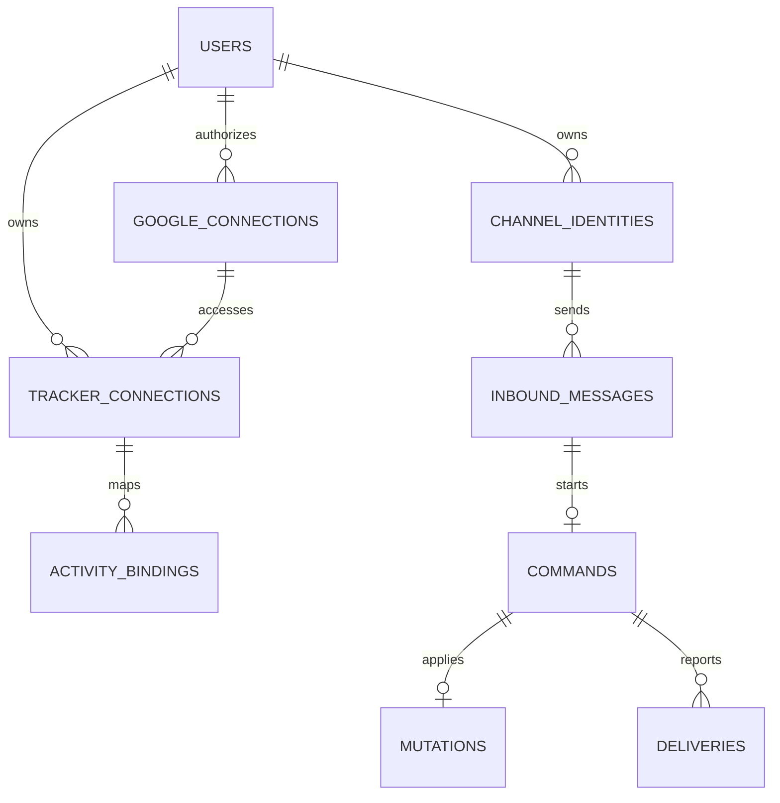
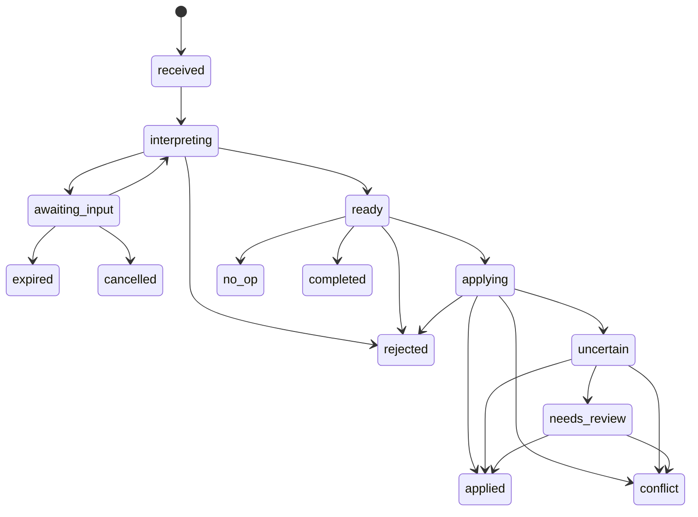

> Implementasi v2: keputusan pengguna pada [ADR 0001](adr/0001-primary-environment-full-mvp.md) menggantikan lingkup v1 yang menyebut lima aktivitas, dua provider, database disposable, atau larangan Supabase. Runtime dan integration tests memakai .env serta Supabase utama. Bukti aktual ada di [IMPLEMENTATION_STATUS.md](IMPLEMENTATION_STATUS.md).

Pembaruan 19 Oktober 2026: Tambahan schema aktif: preferensi/nama terenkripsi pada users, purpose/kebijakan pada sesi onboarding, rute interpretasi pada commands, durasi provider_attempts, reminder_occurrences, dan delivery_origin/FK reminder. Lihat [ADR 0012](adr/0012-conversation-and-reminders.md) dan migrasi 20261019085415.

# Schema dan Kontrak: SDJ Assistant

Pembaruan 19 Oktober 2026: migrasi `20261019062439_openrouter_free_fallback.sql` menambahkan provider `openrouter` dengan bucket bersama dan gate SQL consent `free-providers-v2`. Izin awal v1 tetap untuk tiga provider asal; pembaruan v2 diminta melalui DM sebelum OpenRouter. `User.providerPolicyVersion` membawa versi persetujuan untuk use case; detail pada [ADR 0010](adr/0010-openrouter-free-fallback.md).

Versi: 1.0.0  
Tanggal: 15 Oktober 2026  
Status: spesifikasi schema untuk diturunkan menjadi migration dan runtime validator  
Rujukan: [PRD.md](PRD.md), [ARCHITECTURE.md](ARCHITECTURE.md), [AGENTS.md](AGENTS.md).

## 1. Cara menggunakan dokumen ini

Bagian ini menetapkan nama entity, tipe, relasi, constraint, status, dan kontrak. Tabel field adalah spesifikasi normatif. Cuplikan SQL menunjukkan constraint penting, bukan migration lengkap yang sudah dijalankan. Implementasi wajib membuat migration SQL berversi dan mengujinya dengan PostgreSQL menggunakan role aplikasi sebenarnya.

Tidak ada data peserta asli, API key, token, spreadsheet ID asli, atau nomor telepon asli dalam contoh. Nama dan ID contoh adalah sintetis.

## 2. Konvensi

- Primary key: UUID yang dibuat aplikasi dengan generator aman. Tidak mengasumsikan extension UUID tertentu tersedia.
- Instant waktu: `timestamptz`, disimpan UTC. Tanggal aktivitas: `date` tanpa timezone.
- Semua timestamp diberi `created_at NOT NULL DEFAULT now()`. Entity yang berubah juga memiliki `updated_at`. `updated_at` dikelola repository atau trigger konsisten pada migration.
- Semua field NOT NULL kecuali ditulis `?`. `CHECK` dan ENUM values diterapkan sebagai CHECK text agar migration state lebih mudah. Array/string JSON wajib divalidasi runtime secara strict.
- Data milik peserta selalu mempunyai `user_id`. `id` tetap unik global, dan tambahan `UNIQUE(id, user_id)` mendukung composite foreign key.
- Foreign key antar entity peserta wajib menyertakan `user_id`. Jangan hanya memeriksa ownership pada UI.
- `ciphertext` berarti `bytea` envelope AEAD yang memuat version, nonce, tag, dan ciphertext. AAD mengikat tabel, kolom, user, dan row ID. Gunakan key version, bukan key di database.
- Nilai lookup sensitif menggunakan HMAC secret terpisah, bukan hash polos nomor atau skor dengan ruang kemungkinan kecil.
- `version bigint` mulai 1 untuk optimistic concurrency. Bukan revision resmi Google.
- Skema data aplikasi awal bernama `sdj`. Tidak ada direct browser database access.

## 3. Peta relasi



Katalog template dan tabel provider bersifat konfigurasi global. Onboarding, job, reservation, dan attempt tidak ditampilkan pada diagram agar hubungan inti tetap terbaca.

## 4. Identity dan koneksi

### 4.1 `users`

| Field | Tipe | Aturan |
| --- | --- | --- |
| id | uuid PK | ID peserta internal |
| display_name | text? | Opsional, maksimal 100 karakter, tidak menjadi identitas |
| timezone | text | Default `Asia/Jakarta`, harus IANA timezone yang valid |
| status | text | `pending`, `active`, `suspended`, `deleting`, `deleted` |
| ai_processing_allowed | boolean | Default false sampai persetujuan onboarding |
| privacy_notice_version | text? | Wajib saat active |
| consented_provider_policy_version | text? | Menunjuk daftar provider yang diizinkan saat consent |
| consented_at | timestamptz? | Waktu persetujuan |
| deletion_requested_at | timestamptz? | Dasar pekerjaan penghapusan |
| version | bigint | Optimistic concurrency |

Satu DM dari sender baru boleh membuat user `pending` melalui ingress resolver sempit. Status ini tidak memberi akses tracker. Aktivasi user memerlukan onboarding selesai.

### 4.2 `channel_identities`

| Field | Tipe | Aturan |
| --- | --- | --- |
| id, user_id | uuid | PK dan FK users |
| channel | text | MVP `whatsapp`, fake adapter hanya test |
| channel_account_id | text | Akun bot dari allowlist bridge |
| sender_lookup | bytea | HMAC dari tuple kanal, akun, sender asli |
| sender_ciphertext | bytea | Sender opaque ID untuk routing |
| phone_ciphertext | bytea? | E.164 hanya bila tersedia dan tervalidasi |
| status | text | `active`, `revoked` |
| verified_at | timestamptz | Bukti observasi DM dari ingress tepercaya, bukan bukti legal pemilik nomor |

Constraints: unique `(channel, channel_account_id, sender_lookup)` sepanjang masa retensi. Partial unique satu identity active per user pada MVP. Rebinding nomor/identity yang telah ada memerlukan proses pemulihan eksplisit, bukan pembuatan user baru yang mengambil alih koneksi lama.

### 4.3 `onboarding_sessions`

| Field | Tipe | Aturan |
| --- | --- | --- |
| id, user_id | uuid | PK, FK user |
| identity_id | uuid | FK komposit identity milik user |
| source_message_id | uuid | Event asal untuk rute balasan |
| link_token_hash | bytea UNIQUE | Token sekali pakai, tidak simpan raw |
| browser_session_hash | bytea? | Sesudah penukaran link |
| oauth_state_hash | bytea? UNIQUE | Sekali pakai, terikat browser session |
| oauth_nonce_hash | bytea? | Jika ID token dipakai |
| pkce_verifier_ciphertext | bytea? | Sementara |
| pending_google_connection_id | uuid? | Candidate milik user yang sama |
| pending_tracker_id | uuid? | Candidate milik user yang sama |
| channel_challenge_hash | bytea? | Challenge ke DM asal |
| challenge_attempts | integer | 0 sampai 5 |
| status | text | `created`, `browser_bound`, `oauth_pending`, `file_selection`, `channel_confirmation`, `completed`, `expired`, `cancelled` |
| expires_at | timestamptz | Maksimal 10 menit sejak dibuat, tidak diperpanjang tanpa sesi baru |
| consumed_at | timestamptz? | Saat selesai/dibatalkan |

Partial unique satu sesi belum terminal per identity. Perpindahan status memerlukan compare-and-set. Candidate token/file dibersihkan jika expired. Link token dan OAuth state adalah dua token berbeda.

### 4.4 `google_connections`

| Field | Tipe | Aturan |
| --- | --- | --- |
| id, user_id | uuid | PK, FK user |
| google_subject_lookup | bytea | HMAC dari subject stabil |
| google_subject_ciphertext | bytea | Subject asli |
| email_ciphertext | bytea? | Untuk tampilan terautentikasi bila dibutuhkan |
| refresh_token_ciphertext | bytea? | Nullable setelah revoke. Wajib active/reauth_required |
| encryption_key_version | text | Versi key envelope |
| granted_scopes | text[] | Izin yang benar-benar diberikan |
| status | text | `pending`, `active`, `reauth_required`, `revoked` |
| consented_at | timestamptz | Waktu grant |
| revoked_at | timestamptz? | Waktu pencabutan lokal/terdeteksi |
| last_refresh_at | timestamptz? | Metadata tanpa token |
| last_error_code | text? | Normalized code, bukan body Google |
| version | bigint | Mencegah stale refresh overwrite |

Partial unique `(user_id)` ketika status `active` atau `reauth_required`, sesuai satu akun Google operasional pada MVP. Candidate pending dapat hidup bersamaan sampai konfirmasi kanal. Aktivasi candidate menonaktifkan koneksi dan mapping lama dalam transaksi yang sama. Access token hanya di memori cache scoped connection dan tidak wajib disimpan DB.

### 4.5 `tracker_connections`

| Field | Tipe | Aturan |
| --- | --- | --- |
| id, user_id | uuid | PK, FK user |
| google_connection_id | uuid | FK komposit koneksi user |
| spreadsheet_id | text | Native file ID hasil verifikasi Google, tidak berasal dari model |
| sheet_id | integer | Numeric sheetId Google, >=0 |
| sheet_title | text | Nama tab terakhir yang tervalidasi |
| template_id | text | FK template version |
| status | text | `pending`, `active`, `needs_validation`, `reauth_required`, `disabled`, `archived` |
| structure_fingerprint | text? | Hash struktur relevan, bukan semua nilai aktivitas |
| config_version | bigint | Naik setiap perubahan mapping |
| validated_at | timestamptz? | Waktu validasi terakhir |
| disabled_reason | text? | Kode terstruktur |
| version | bigint | Optimistic concurrency |

Unique tambahan `(id, user_id, template_id)`. Partial unique satu tracker operasional per user untuk status `active`, `needs_validation`, `reauth_required`. Partial unique `spreadsheet_id` untuk status yang sama memastikan satu file tidak dipetakan aktif kepada dua peserta, meskipun keduanya mempunyai akses Google.

Pemilihan file sama oleh user lain menghasilkan error generik `TRACKER_ALREADY_REGISTERED`. Jangan mengungkap siapa pemilik mapping. Koneksi suspended user tetap mempertahankan reservasi tracker sampai dinonaktifkan melalui alur pemulihan.

## 5. Template dan binding

### 5.1 `template_versions`

| Field | Tipe | Aturan |
| --- | --- | --- |
| id | text PK | Contoh `sdj-v1.2-core` |
| schema_version | integer | Versi format konfigurasi, awal 1 |
| config_sha256 | text | Hash file konfigurasi yang di-commit |
| header_row_index | integer | Zero-based, template awal 6 |
| first_input_column_index | integer | Zero-based, awal 9 |
| expected_sheet_title | text | `NEW SDJ v1.2` |
| status | text | `draft`, `enabled`, `retired` |

Template yang telah enabled bersifat immutable. Perubahan semantik membuat ID versi baru. File template pada repository adalah sumber konfigurasi, DB merupakan registry versi deploy.

### 5.2 `activity_definitions`

PK komposit `(template_id, activity_id)`.

| Field | Tipe | Aturan |
| --- | --- | --- |
| template_id | text | FK template |
| activity_id | text | Slug stabil, bukan label dari model |
| display_label | text | Nama pada balasan |
| accepted_source_labels | jsonb | Array label yang dipakai validator template |
| aliases | jsonb | Array alias parser yang eksplisit |
| value_kind | text | `number`, `boolean` |
| min_value, max_value | numeric? | Untuk number, min <= max |
| integer_only | boolean | True untuk skor salat |
| unit | text | `score`, `page`, `execution`, atau unit yang disahkan |
| enabled | boolean | Default false sampai kontrak disahkan |

### Profil awal dan aktivitas tertunda

| Activity ID | Label baris sumber | Baris awal 1-based | Tipe/nilai | Aktif MVP |
| --- | --- | --- | --- | --- |
| subuh | Subuh Berjama'ah/Awal Waktu | 9 | Integer 0–3 | Ya |
| dzuhur | Dzuhur Berjama'ah/Awal Waktu | 10 | Integer 0–3 | Ya |
| ashar | Ashar Berjama'ah/Awal Waktu | 11 | Integer 0–3 | Ya |
| maghrib | Maghrib Berjama'ah/Awal Waktu | 12 | Integer 0–3 | Ya |
| isya | Isya Berjama'ah/Awal Waktu | 13 | Integer 0–3 | Ya |
| rawatib | Sholat sunnah rawatib | 14 | Satuan belum disahkan | Tidak |
| tilawah | Tilawah Al Quran (halaman) | 15 | Validasi sumber decimal 0–100, kebijakan pecahan perlu disahkan | Tidak |
| murojaah | Muroja'ah Al Quran (halaman) | 16 | Label menyebut halaman, formula progres yang terbaca menghitung TRUE. Perlu audit semantik | Tidak |
| matsurat_pagi | Al-Matsurat Pagi | 17 | Tipe boolean perlu pemeriksaan hasil konversi | Tidak |
| matsurat_petang | Al-Matsurat Petang | 18 | Sama | Tidak |
| dhuha | Sholat Dhuha (pelaksanaan) | 19 | Sama | Tidak |
| tahajjud | Sholat Tahajjud (pelaksanaan) | 20 | Sama | Tidak |
| infaq | Infaq/Ajak Infaq (pelaksanaan) | 21 | Pelaksanaan, bukan nominal uang, perlu disahkan | Tidak |
| puasa_sunnah | Shaum/Puasa Sunnah | 22 | Tipe boolean perlu pemeriksaan | Tidak |
| merapikan_kamar | Merapikan Kamar (Setiap Hari) | 23 | Sama | Tidak |

Label di atas diringkas tanpa emoji untuk keterbacaan. Konfigurasi implementasi menyimpan label asli yang telah dinormalisasi dengan aturan eksplisit. Menghapus emoji boleh, menghapus kata yang membedakan dua aktivitas tidak boleh. Nomor baris adalah observasi sumber, bukan alamat tulis yang selalu berlaku.

### 5.3 `activity_bindings`

| Field | Tipe | Aturan |
| --- | --- | --- |
| id, user_id | uuid | PK, FK user |
| tracker_id | uuid | FK komposit tracker |
| template_id, activity_id | text | FK definisi aktivitas |
| row_index | integer | Zero-based, diverifikasi dari label |
| normalized_label_hash | text | Sentinel label |
| binding_version | bigint | Cocok dengan config_version tracker |

FK triple `(tracker_id,user_id,template_id)` memastikan definisi template cocok dengan tracker. Unique `(tracker_id,activity_id)`, unique `(tracker_id,row_index)` untuk profil awal, dan unique `(id,user_id,tracker_id,activity_id)` untuk parent key mutation. Binding tanpa aktivitas enabled tidak boleh dipakai menulis walaupun row cocok.

Date-to-column mapping adalah cache yang dapat direkonstruksi dari header Google. Tidak memerlukan tabel authoritative. Cache key mencakup tracker ID, config version, dan fingerprint. Snapshot koordinat spesifik disimpan pada mutation.

Implementasi adaptif mengikuti [ADR 0006](adr/0006-adaptive-tracker-configuration.md). Binding menyimpan baris yang ditemukan dan hash label aktual yang dinormalisasi. Kolom label/baris header/pemetaan tanggal direkonstruksi dari sheet dan termasuk fingerprint adaptif; tidak ada kolom database baru. Fingerprint acuan mempertahankan format lama. Ringkasan onboarding berisi mode, jumlah aktivitas/tanggal dan rentang tanggal tanpa nilai aktivitas.

[ADR 0007](adr/0007-automatic-input-validation-repair.md) menambahkan field opsional `configuration.repairedValidationCells` (jumlah sel) pada hasil validasi browser/DM. `TrackerGateway.validate` dapat memperbaiki aturan input saat onboarding; pembacaan `inspect` tetap tidak menulis aturan. Tidak ada perubahan schema database atau nilai catatan. Aturan yang baru dikirim harus terverifikasi sebelum hasil validasi dinyatakan berhasil.

[ADR 0008](adr/0008-legacy-boolean-numeric-inputs.md) menambahkan `configuration.resetInputCells` (jumlah sel, opsional). Boolean native pada aktivitas angka disimpan pada note sel sebagai rekam pemulihan sebelum dikosongkan. Hasil clear dan note dibaca ulang sebelum koneksi dinyatakan lolos; tidak ada perubahan schema database.

[ADR 0009](adr/0009-complete-tracker-normalization.md) mengganti backup note dengan tab cadangan tersembunyi dan menambahkan `convertedInputCells` (opsional). Port `repairStep` mengembalikan `TrackerValidation` atau `TrackerRepairProgress`; adapter lama tetap memakai `validate`. Rekam mentah mendukung number/bool/string/formula/effective value, note dan aturan asal; normalizer menghasilkan typed number/boolean/blank dan aturan standar. Seluruh JSON backup diverifikasi dan tujuan diregenerasi dari katalog/layout sebelum ditulis. Tidak ada migrasi database.

`POST /connect/tracker` menerima `repair_version:1` dan `continuation_token?` (maksimal 4096 karakter). Respons 202 berisi `accepted:false`, `repairing:true`, `continuationToken`, `progress`, serta `retrying?`; respons akhir 200 tetap `{accepted:true,configuration}`. Token AES-GCM mengikat user/sesi/koneksi/file/tab/run/fingerprint/expiry dan tidak menyimpan nilai aktivitas. Klien lama yang menerima progres diarahkan memuat ulang melalui 409 `CLIENT_UPDATE_REQUIRED`. Tidak menyimpan kandidat tracker/binding atau mengirim challenge sebelum hasil akhir terverifikasi.

## 6. Pesan, command, dan perubahan

### 6.1 `inbound_messages`

| Field | Tipe | Aturan |
| --- | --- | --- |
| id, user_id | uuid | PK, FK user |
| identity_id | uuid | FK komposit identity |
| channel, channel_account_id | text | Snapshot route metadata |
| external_message_id | text | ID kanal, tidak dibentuk dari teks |
| conversation_ciphertext | bytea | Tujuan balasan dari event asli |
| text_ciphertext | bytea? | Raw text terenkripsi, dihapus setelah 7 hari |
| body_digest | bytea | HMAC body untuk mendeteksi collision event ID |
| sent_at | timestamptz? | Timestamp kanal |
| received_at | timestamptz | First server receipt, immutable |
| routed_command_id | uuid? | Command yang dimulai atau dilanjutkan pesan ini |
| kind | text | `text`, `unsupported` |
| status | text | `received`, `routed`, `ignored`, `rejected` |

Unique `(channel, channel_account_id, external_message_id)`. Event ID sama dan body digest berbeda dikarantina sebagai collision, tidak memperbarui pesan lama. Duplikat tidak mengganti received_at, user, atau route. Routed command menggunakan FK komposit user yang sama setelah command dibuat.

### 6.2 `commands`

| Field | Tipe | Aturan |
| --- | --- | --- |
| id, user_id | uuid | PK, FK user |
| identity_id | uuid | FK komposit identity |
| origin_message_id | uuid UNIQUE | FK komposit pesan asal |
| tracker_id | uuid? | FK komposit, null untuk bantuan/onboarding |
| action | text? | `set_activity`, `daily_summary`, `undo_last`, `help`, `connection_status`, `connect`, `disconnect`, `clear_activity` |
| parser_source | text? | `deterministic`, `ai`, `system` |
| intent_ciphertext | bytea? | Validated/resolved intent yang mengandung nilai |
| timezone_snapshot | text | Diambil dari user saat mulai |
| reference_received_at | timestamptz | Sama dengan timestamp first message, immutable |
| local_date | date? | Tanggal hasil resolusi, dibekukan sebelum ready |
| status | text | Lihat state machine |
| clarification_ciphertext | bytea? | Pending slots yang boleh diisi |
| expires_at | timestamptz? | Wajib untuk pending clarification |
| result_code | text? | Kode dari katalog error |
| completed_at | timestamptz? | Terminal timestamp |
| version | bigint | Compare-and-set transition |

Unique `(id,user_id)` serta `(id,user_id,tracker_id)` bila mutation membutuhkan ownership tracker. Partial unique `(identity_id)` ketika `status='awaiting_input'`. Pergantian pending command harus men-terminal-kan command lama dahulu.

Status:



`completed` digunakan untuk read-only/system commands. `applied` hanya mutation terverifikasi. `rejected` dari applying hanya jika kegagalan definitif memastikan tidak ada write. Outcome tidak diketahui wajib uncertain. `needs_review` bukan terminal untuk barrier tracker.

### 6.3 `mutations`

| Field | Tipe | Aturan |
| --- | --- | --- |
| id, user_id | uuid | PK, FK user |
| command_id | uuid UNIQUE | Satu mutation per command pada MVP |
| tracker_id | uuid | FK komposit tracker dan command tracker |
| activity_id | text | ID yang sudah divalidasi |
| binding_id | uuid | FK `(binding_id,user_id,tracker_id,activity_id)` ke binding yang sama |
| activity_date | date | Snapshot tanggal |
| sheet_id | integer | Snapshot numeric sheetId |
| row_index, column_index | integer | Zero-based, >=0 |
| tracker_config_version | bigint | Snapshot konfigurasi |
| structure_fingerprint | text | Snapshot sebelum write |
| operation | text | `set`, `restore`, `clear` |
| before_value_ciphertext | bytea | TypedCellValue lama |
| after_value_ciphertext | bytea | TypedCellValue tujuan |
| before_value_hmac, after_value_hmac | bytea | Fingerprint bertipe untuk audit internal, bukan log publik |
| status | text | `prepared`, `sending`, `verified`, `uncertain`, `needs_review`, `conflict`, `failed` |
| undo_of_id | uuid? | Self-FK komposit user dan tracker sama |
| send_attempts | integer | >=0, maksimal 3 pada jalur set/reconcile |
| write_started_at | timestamptz? | Saat pengiriman dimulai |
| verified_at | timestamptz? | Wajib saat verified |
| last_error_code | text? | Normalized code |
| reconcile_after | timestamptz? | Jadwal pemeriksaan |
| version | bigint | Compare-and-set transition |

Unique `(id,user_id,tracker_id)`. FK command menggunakan `(command_id,user_id,tracker_id)`. Binding FK juga mengikat tracker dan aktivitas. Partial unique `(tracker_id)` untuk status `prepared`, `sending`, `uncertain`, `needs_review`: satu mutation belum pasti per tracker. Partial unique `(undo_of_id)` bila not null dan status bukan `failed`/`conflict`: satu undo yang masih berjalan atau berhasil per asal. Undo yang definitif tidak berefek boleh dicoba kembali selama seluruh syarat eligibility masih terpenuhi.

`failed` berarti sudah terbukti tidak ada efek write. `conflict` berarti ada perubahan/struktur lain sehingga aplikasi berhenti tanpa menimpa. Keduanya melepas barrier setelah pemeriksaan penyelesaian request lama. Journal yang sudah verified immutable kecuali penambahan metadata nonsemantik. Jangan mengubah old/new values untuk mengesankan operasi berhasil.

### 6.4 `deliveries`

| Field | Tipe | Aturan |
| --- | --- | --- |
| id, user_id | uuid | PK, FK user |
| command_id | uuid? | FK komposit command |
| identity_id | uuid | FK komposit identity |
| source_message_id | uuid | FK komposit pesan yang menentukan route |
| dedupe_key | text | Contoh internal `command-id:terminal:v1` |
| body_ciphertext | bytea | Teks balasan terenkripsi |
| kind | text | `onboarding`, `clarification`, `pending`, `terminal`, `status` |
| status | text | `pending`, `leased`, `sent`, `delivery_unknown`, `failed`, `cancelled` |
| attempts | integer | >=0 |
| available_at | timestamptz | Retry schedule |
| lease_token_hash | bytea? | Token claim bridge |
| lease_expires_at | timestamptz? | Waktu klaim berakhir |
| remote_message_id | text? | Hasil kanal |
| sent_at | timestamptz? | Wajib ketika sent |
| last_error_code | text? | Normalized error |

Unique `(user_id,dedupe_key)`. Destination dibentuk server dari source_message/identity, tidak diterima dari output AI. Pesan pending dan terminal menggunakan dedupe key berbeda. Timeout delivery tidak mengubah status mutation kembali ke applying.

### 6.5 `jobs`

| Field | Tipe | Aturan |
| --- | --- | --- |
| id, user_id | uuid | PK, FK user |
| kind | text | `process_message`, `apply_command`, `reconcile_mutation` |
| message_id | uuid? | FK komposit inbound |
| command_id | uuid? | FK komposit command |
| mutation_id | uuid? | FK komposit mutation |
| dedupe_key | text | Unique bersama user |
| status | text | `queued`, `leased`, `done`, `failed`, `cancelled` |
| available_at | timestamptz | Jadwal pekerjaan |
| attempts, max_attempts | integer | 0 <= attempts <= max_attempts |
| lease_owner | text? | Worker opaque ID |
| lease_token_hash | bytea? | Mencegah stale ack |
| lease_expires_at | timestamptz? | Default 60 detik, worker refresh terbatas |
| last_error_code | text? | Normalized code |

CHECK memastikan tepat satu entity reference terisi dan cocok dengan kind. Contoh process_message hanya message_id. Payload tidak berisi token/teks/aktor dari model. Jobs bukan tempat menunggu reset AI harian. Cleanup retensi dijalankan scheduler administratif terpisah dengan scope yang diaudit.

## 7. Provider dan kuota bersama

Tabel berikut operasional global dan tidak boleh diakses langsung peserta. Secret hanya berada di secret store. Peserta tidak dapat memilih credential atau provider melalui chat.

### 7.1 `ai_targets`

| Field | Tipe | Aturan |
| --- | --- | --- |
| id | text PK | Nama internal stabil |
| provider | text | `gemini`, `groq`, adapter lain setelah ADR |
| model_id | text | Model aktual diverifikasi saat deploy |
| credential_ref | text | Referensi secret |
| priority | integer | Lebih kecil lebih dulu |
| enabled | boolean | Default false sampai evaluasi lulus |
| supports_strict_schema | boolean | Capability tervalidasi |
| max_input_tokens, max_output_tokens | integer | >0 |
| timeout_ms | integer | Default <=4000 pada pilot |
| provider_policy_version | text | Harus tercakup consent user |
| configuration_version | text | Traceability |
| disabled_reason | text? | Kode terstruktur |

### 7.2 `quota_buckets`

Satu row mewakili satu limit dimension, misalnya project X requests/minute, bukan sekadar API key.

| Field | Tipe | Aturan |
| --- | --- | --- |
| id | uuid PK | Bucket internal |
| provider | text | Provider pemilik limit |
| owner_ref | text | Project/org pseudonym dari config, bukan secret |
| scope_key | text | Model/scope bucket sesuai provider |
| metric | text | `requests`, `tokens`, `input_tokens`, `output_tokens`, sesuai limit aktual provider |
| window_kind | text | `minute`, `day`, `custom` |
| limit_value | bigint? | Null berarti belum diketahui, bukan unlimited |
| state | text | `available`, `cooldown`, `quota_exhausted`, `quota_unknown`, `disabled`, `half_open` |
| window_started_at | timestamptz? | Window estimasi lokal |
| reset_at | timestamptz? | Berdasarkan metadata/provider policy |
| used_estimate, reserved_estimate | bigint | >=0 |
| remaining_observed | bigint? | Snapshot header, bukan counter authoritative lintas semua client |
| observed_at | timestamptz? | Waktu snapshot |
| blocked_until | timestamptz? | Jadwal eligibility |
| failure_count | integer | >=0 |
| probe_lease_token_hash | bytea? | Satu half-open probe |
| probe_lease_expires_at | timestamptz? | Expiry probe |
| version | bigint | Compare-and-set |

Unique `(provider,owner_ref,scope_key,metric,window_kind)`. Local estimate tidak dianggap mengetahui traffic dari aplikasi lain pada akun provider yang sama. Reset bukan perintah menghapus seluruh counter tanpa dasar window yang jelas.

### 7.3 `ai_target_buckets`

PK `(target_id,bucket_id)`, FK kedua tabel. Satu model dapat memerlukan beberapa bucket sekaligus, dan beberapa model/key dapat berbagi bucket. Reservasi seluruh bucket target dilakukan dalam urutan ID tetap pada satu transaksi agar tidak deadlock.

### 7.4 `provider_attempts`

| Field | Tipe | Aturan |
| --- | --- | --- |
| id, user_id | uuid | PK dan FK user |
| command_id | uuid | FK komposit command |
| target_id | text | FK ai target |
| attempt_no | integer | 1 sampai 3 |
| status | text | `reserved`, `started`, `succeeded`, `failed`, `unknown` |
| started_at, finished_at | timestamptz? | Durasi |
| prompt_version, output_schema_version | text | Versi kontrak |
| input_tokens, output_tokens | integer? | Actual usage jika tersedia |
| normalized_error | text? | Error classification |
| retry_after_ms | bigint? | Metadata provider yang sudah dinormalisasi |

Unique `(command_id,attempt_no)`. Tidak menyimpan raw prompt, raw output, API key, atau full provider error response. Snapshot model/config yang digunakan harus dapat ditelusuri lewat target configuration version.

### 7.5 `provider_reservations`

| Field | Tipe | Aturan |
| --- | --- | --- |
| attempt_id | uuid | FK provider_attempts |
| bucket_id | uuid | FK quota_buckets |
| reserved_amount | bigint | >=0 |
| settled_amount | bigint? | Usage aktual/konservatif, >=0 |
| status | text | `held`, `settled`, `expired_unknown` |
| expires_at | timestamptz | Batas reservasi |

PK `(attempt_id,bucket_id)`. Mengakhiri attempt timeout tidak langsung menganggap pemakaian nol. Settle konservatif agar retry tidak menggelembungkan kapasitas semu. Reaper melepaskan reservation dengan prosedur yang menjaga counter tidak negatif. Fairness user berasal dari jumlah attempts per user pada window yang relevan, bukan hanya bucket global.

### 7.6 `bridge_nonces`

Field: `key_id text`, `nonce_hash bytea`, `expires_at timestamptz`, `created_at timestamptz`. PK `(key_id,nonce_hash)`, index expires_at. Tabel ini milik ingress auth role saja. Tidak menyimpan body pesan. Konfigurasi key allowlist berada di deployment secret/config, bukan tabel yang dapat ditulis peserta.

## 8. Invariants dan constraint SQL penting

Contoh ini memerlukan tabel dan kolom di atas sudah dibuat. Nama index/constraint final harus unik dan konsisten pada migration.

```sql
-- Satu tracker operasional per peserta dan per file.
CREATE UNIQUE INDEX tracker_one_operational_per_user
ON sdj.tracker_connections (user_id)
WHERE status IN ('active', 'needs_validation', 'reauth_required');

CREATE UNIQUE INDEX tracker_file_operational_owner
ON sdj.tracker_connections (spreadsheet_id)
WHERE status IN ('active', 'needs_validation', 'reauth_required');

-- Parent menyediakan unique key komposit.
ALTER TABLE sdj.google_connections
  ADD CONSTRAINT google_connection_id_user_unique UNIQUE (id, user_id);

ALTER TABLE sdj.tracker_connections
  ADD CONSTRAINT tracker_google_same_user_fk
  FOREIGN KEY (google_connection_id, user_id)
  REFERENCES sdj.google_connections (id, user_id);

CREATE UNIQUE INDEX one_unresolved_mutation_per_tracker
ON sdj.mutations (tracker_id)
WHERE status IN ('prepared', 'sending', 'uncertain', 'needs_review');

CREATE UNIQUE INDEX one_undo_per_mutation
ON sdj.mutations (undo_of_id)
WHERE undo_of_id IS NOT NULL AND status NOT IN ('failed', 'conflict');

ALTER TABLE sdj.inbound_messages
  ADD CONSTRAINT inbound_external_event_unique
  UNIQUE (channel, channel_account_id, external_message_id);

ALTER TABLE sdj.jobs
  ADD CONSTRAINT job_entity_matches_kind CHECK (
    (kind = 'process_message' AND message_id IS NOT NULL
      AND command_id IS NULL AND mutation_id IS NULL)
    OR (kind = 'apply_command' AND command_id IS NOT NULL
      AND message_id IS NULL AND mutation_id IS NULL)
    OR (kind = 'reconcile_mutation' AND mutation_id IS NOT NULL
      AND message_id IS NULL AND command_id IS NULL)
  );
```

Constraint tambahan wajib: nonnegative indexes/counters, permitted statuses, verified_at saat mutation verified, completed_at saat command terminal, expires_at untuk awaiting_input, token ada untuk Google active, dan tepat satu pending clarification per identity. Cross-field semantic checks dilakukan domain karena payload nilai terenkripsi.

Jangan memakai cascade delete umum pada journal ketika mengarsipkan tracker. FK default RESTRICT. Penghapusan akun adalah workflow terurut yang menunggu mutation in-flight selesai, membatalkan jobs, menghapus token dan data sesuai retensi.

## 9. Tenant scope, RLS, dan database roles

### Roles

| Role | Tugas | Batas |
| --- | --- | --- |
| `sdj_migrator` | Membuat tabel/policy/index | Tidak digunakan request runtime |
| `sdj_app` | Use case peserta | Non-owner, tanpa BYPASSRLS, tidak dapat membaca secret global bebas |
| `sdj_ingress` | Lookup/create identity pending melalui fungsi sempit, nonce validation | Tidak dapat memilih token Google atau nilai mutation |
| `sdj_scheduler` | Claim job/outbox dan update lease melalui fungsi sempit | Tidak membaca ciphertext peserta untuk keperluan operator |
| `sdj_maintenance` | Retensi, tombstone, backup sesuai runbook | Credential terpisah, audit, bukan web request |

Function `SECURITY DEFINER` bila digunakan wajib fixed `search_path`, owner terbatas, no dynamic SQL, execute grant spesifik, revoke PUBLIC, dan integration tests. Jangan membuat fungsi arbitrer `get_user_data(user_id)` yang meniadakan isolasi.

### Pola tenant transaction

```sql
BEGIN;
SELECT set_config('app.user_id', $1, true);
-- $1 diisi server dari actor yang sudah diverifikasi.
-- Semua repository tenant-scoped dijalankan pada connection/transaction ini.
COMMIT;
```

Contoh policy satu tabel:

```sql
ALTER TABLE sdj.commands ENABLE ROW LEVEL SECURITY;
ALTER TABLE sdj.commands FORCE ROW LEVEL SECURITY;

CREATE POLICY commands_tenant_policy ON sdj.commands
FOR ALL TO sdj_app
USING (
  user_id = nullif(current_setting('app.user_id', true), '')::uuid
)
WITH CHECK (
  user_id = nullif(current_setting('app.user_id', true), '')::uuid
);
```

Terapkan pola yang setara pada semua tabel peserta, termasuk values-bearing journal dan provider_attempts. Untuk users gunakan `id`, bukan user_id. Tidak ada akses ketika tenant context belum dipasang. Jangan `SET` global pada pooled connection. Scope transaksi harus tetap melekat ketika repository dipanggil, bukan membuka query di connection lain.

RLS melindungi dari query yang lupa filter, bukan dari server tepercaya yang sengaja mengganti context. Karena itu actor construction, bridge auth, FK komposit, dan larangan user_id dari model tetap wajib. Bypass role untuk queue tidak boleh dipakai menjalankan business query user secara umum.

## 10. Kontrak nilai dan intent runtime

### Typed cell value

```ts
type TypedCellValue =
  | { kind: "blank" }
  | { kind: "number"; value: number }
  | { kind: "boolean"; value: boolean };
```

Number wajib finite, sesuai rentang aktivitas dan integer bila diperlukan. `0`, `false`, dan blank adalah tiga keadaan berbeda. Formula bukan TypedCellValue yang boleh ditimpa. Saat membaca Google, simpan formula marker terpisah untuk guard.

### AI proposal versi 1

```ts
type ActivityId = "subuh" | "dzuhur" | "ashar" | "maghrib" | "isya";

type DateReference =
  | { kind: "today" }
  | { kind: "yesterday" }
  | { kind: "explicit"; date: string }; // ISO date tervalidasi

type CommandProposal =
  | {
      schema_version: 1;
      action: "set_activity";
      activity_id: ActivityId;
      date_reference: DateReference;
      value: number;
    }
  | {
      schema_version: 1;
      action: "daily_summary";
      date_reference: DateReference;
    }
  | {
      schema_version: 1;
      action: "clarify";
      missing: ("activity" | "date" | "value")[];
      partial?: {
        activity_id?: ActivityId;
        date_reference?: DateReference;
        value?: number;
      };
    }
  | {
      schema_version: 1;
      action: "unsupported";
    };
```

Implementasi memakai Zod strict/discriminated union. Reject unknown keys. `missing` harus nonempty dan tanpa duplikat. Nilai partial disimpan terenkripsi sebagai kandidat klarifikasi dan tidak pernah dieksekusi sebelum proposal lengkap divalidasi ulang. Schema AI tidak mencakup `user_id`, `tracker_id`, `spreadsheet_id`, range, SQL, credential, URL, atau instruksi tool. Jangan menambahkan `confidence` sebagai penentu izin menulis. Skor confidence model bukan bukti kebenaran.

Provider yang tidak mendukung bentuk union secara native boleh memakai provider-specific schema envelope, lalu adapter menormalisasi ke kontrak domain yang sama. Jangan mengubah semantic rules untuk menyesuaikan satu provider.

### Resolved command internal

```ts
type ActorContext = Readonly<{
  userId: string;
  identityId: string;
  sourceMessageId: string;
}>;

type ResolvedSetCommand = Readonly<{
  commandId: string;
  trackerId: string;
  trackerConfigVersion: number;
  activityId: ActivityId;
  localDate: string;
  timezoneSnapshot: string;
  afterValue: { kind: "number"; value: number };
}>;
```

ActorContext dibuat server. TypeScript `readonly` membantu implementasi, bukan authorization boundary. Semua use case tetap memeriksa actor, status, dan FK melalui repository.

## 11. Kontrak HTTP aplikasi yang direncanakan

Semua endpoint adalah milik produk yang akan dibuat. Bukan endpoint bawaan OpenClaw atau Google.

| Method/path | Auth | Hasil utama |
| --- | --- | --- |
| `POST /internal/v1/channel-events` | Bridge HMAC | Event persisten atau duplicate ack |
| `POST /internal/v1/deliveries/claim` | Bridge HMAC scope account | Delivery dengan route server dan lease token |
| `POST /internal/v1/deliveries/:id/ack` | Bridge HMAC + lease | Delivery sent, tidak memicu command |
| `POST /internal/v1/deliveries/:id/nack` | Bridge HMAC + lease | Retry/unknown delivery |
| `GET /connect?token=...` | Tautan onboarding | Halaman awal tanpa konsumsi token; aman untuk GET/HEAD/pratinjau |
| `POST /connect/exchange` | Token + Origin + custom header; cookie asli untuk resume | Ikat satu browser, atau lanjutkan sesi cookie+token yang sama; TTL tidak diperpanjang |
| `POST /connect/google/start` | Browser session + CSRF | URL OAuth untuk navigasi browser |
| `GET /connect/google/callback` | State + browser session | Candidate Google connection |
| `POST /connect/tracker` | Browser session + CSRF | Validasi file hasil Picker, belum aktivasi |
| `GET /connect/status` | Browser session | Status onboarding sendiri tanpa token |
| `POST /connect/cancel` | Browser session + CSRF | Batalkan candidate |
| `GET /health/live` | Publik, output minimal | Liveness |
| `GET /health/ready` | Privat/monitoring | Readiness tanpa raw dependency errors |

Konfirmasi challenge terjadi melalui DM asal, bukan endpoint browser yang dapat menebak user_id. MVP tidak menyediakan endpoint publik generic `update-cell`, `query-user`, atau `run-tool`.

Format error eksternal:

```json
{
  "error": {
    "code": "TRACKER_REAUTH_REQUIRED",
    "message": "Hubungkan ulang akun Google untuk melanjutkan.",
    "operation_id": "synthetic-operation-id",
    "retryable": false
  }
}
```

HTTP 202 menyatakan diterima, bukan bahwa spreadsheet sudah berubah. Status sukses dikirim berdasarkan outcome worker. Provider error body tidak diteruskan mentah kepada pengguna.

## 12. Katalog error domain

| Code | Makna | Penulisan |
| --- | --- | --- |
| `USER_NOT_CONNECTED` | Onboarding belum selesai | Tidak |
| `IDENTITY_SCOPE_INVALID` | Sender/account tidak cocok | Tidak |
| `VALUE_OUT_OF_RANGE` | Skor invalid | Tidak |
| `DATE_AMBIGUOUS` | Tanggal perlu konfirmasi | Tidak |
| `STALE_MESSAGE_DATE_CONFIRMATION` | Pesan tertunda perlu tanggal eksplisit | Tidak |
| `DATE_OUT_OF_POLICY` | Masa depan/terlalu lampau | Tidak |
| `DATE_NOT_IN_TRACKER` | Header tidak memuat tanggal | Tidak |
| `TRACKER_ALREADY_REGISTERED` | File sudah mempunyai mapping operasional | Tidak |
| `TRACKER_REAUTH_REQUIRED` | Grant tidak berlaku | Tidak |
| `TRACKER_SCHEMA_CHANGED` | Fingerprint/binding tidak sesuai | Tidak |
| `TARGET_CELL_IS_FORMULA` | Target bukan sel input | Tidak |
| `AI_UNAVAILABLE` | Tidak ada interpretasi AI eligible | Tidak |
| `AI_OUTPUT_INVALID` | Output tidak lolos kontrak | Tidak |
| `USER_RATE_LIMITED` | Batas fairness/antispam | Tidak |
| `WRITE_OUTCOME_UNKNOWN` | Request mungkin sudah diterapkan | Jangan replay |
| `WRITE_CONFLICT` | Nilai/struktur berbeda | Jangan overwrite |
| `UNDO_NOT_ELIGIBLE` | TTL/ownership/current value tidak cocok | Tidak |
| `DELIVERY_UNKNOWN` | Balasan mungkin terkirim | Tidak mengulang mutation |
| `DUPLICATE_EVENT_COLLISION` | ID sama dengan body berbeda | Karantina |

## 13. Index, transaksi, dan retensi

### Index minimum

- Semua child FK user-scoped yang sering diquery: `(user_id, parent_id)`.
- Commands `(user_id,created_at DESC)` dan partial index pending expiry.
- Mutations `(tracker_id,created_at DESC)` serta `(user_id,verified_at DESC)`.
- Jobs partial `(available_at,id) WHERE status='queued'`, dan leased expiry.
- Deliveries partial `(available_at,id) WHERE status='pending'`, dan lease expiry.
- Provider attempts `(user_id,started_at)` untuk fairness dan `(target_id,started_at)` untuk monitoring.
- Quota buckets `blocked_until` untuk availability, reservations `(status,expires_at)` untuk recovery.
- Onboarding dan bridge nonces `expires_at` untuk cleanup.

Jangan menambahkan index pada ciphertext. Jangan memasukkan nama peserta atau aktivitas pada label metrics dari query aggregation.

### Batas transaksi

| Transaksi lokal | Entity yang harus commit bersama |
| --- | --- |
| Ingress | Message + job, setelah actor resolution dan dedupe |
| Aktivasi | User consent + Google candidate + tracker/bindings + status onboarding |
| Reservasi AI | Provider attempt + seluruh bucket reservations |
| Prepare write | Mutation prepared + command applying + job state yang sesuai |
| Finalize write | Mutation verified + command applied + delivery terminal + job done |
| Disconnect | Status koneksi/tracker + pembatalan job belum dikirim + notifikasi |

I/O Google, AI, atau WhatsApp berada di luar transaksi SQL panjang. Advisory lock per tracker dipertahankan pada pinned session, tenant transaction tetap singkat. Jika koneksi lock hilang saat request eksternal in-flight, tandai operasi uncertain dan jangan mengizinkan writer pengganti langsung mengulang.

### Retensi

Ikuti [PRD bagian 10](PRD.md#10-privasi-dan-retensi-awal). Cleanup raw text setelah 7 hari tidak menghapus dedupe keys 90 hari. Setelah dedupe horizon, adapter harus menolak replay history lama, bukan memperlakukan event lama sebagai command baru. Jangan menghapus unresolved mutation atau jobs terkait sampai selesai. Eksepsi retensi untuk insiden perlu alasan, batas waktu, dan persetujuan produk.

## 14. Migrasi dan seeding

Urutan implementasi yang disarankan:

1. Roles, users, identities, template registry dan activity definitions.
2. Google connections dan tracker/bindings.
3. Inbound messages, commands, mutations, deliveries.
4. Onboarding dan FK siklik routed_command/source_message/candidate yang ditambahkan setelah parent tersedia.
5. Jobs, provider tables, nonce storage.
6. Constraints, indexes, RLS policies, fungsi sempit ingress/scheduler, dan grants.

Migration runner menyimpan filename, checksum, dan applied_at pada tabel operasional migration. Jangan mengedit migration yang sudah diterapkan. Gunakan forward migration untuk perubahan. Sebelum deploy, uji dari DB kosong dan dari versi sebelumnya dengan data sintetis, termasuk rollback aplikasi jika schema expand/contract.

Seed hanya template lima salat dan target AI disabled tanpa model ID palsu. Tidak ada token dummy yang menyerupai token nyata. Model config baru enabled setelah operator memberi model ID valid dan evaluation report lulus.

## 15. Tes schema yang wajib

1. Menautkan tracker A ke Google connection B gagal pada FK komposit.
2. Role aplikasi user A tidak dapat SELECT/UPDATE commands/mutations B, termasuk query tanpa WHERE user_id.
3. Tanpa `app.user_id`, query tenant mengembalikan nol row dan insert ditolak.
4. Pooled connection tidak membawa tenant context setelah transaksi selesai.
5. Dua registration paralel untuk file sama hanya menghasilkan satu mapping operasional.
6. Dua event identik hanya membuat satu message dan satu proses command.
7. Dua worker tidak membuat dua mutation unresolved pada tracker sama.
8. Repeated undo ditolak unique relation dan eligibility checks.
9. Provider reservations paralel tidak melewati limit lokal yang diketahui atau menghasilkan counter negatif.
10. Job/delivery stale lease token tidak dapat ack pekerjaan yang telah diambil worker lain.
11. Candidate OAuth tidak aktif sebelum konfirmasi identity asal.
12. Deletion workflow tidak menghapus journal yang masih uncertain lalu memicu retry yang kehilangan konteks.

Schema tidak dianggap tervalidasi sebelum migration dan tes tersebut berjalan pada PostgreSQL. Dokumen ini sendiri tidak membuktikan query, constraint, atau RLS telah diuji.
